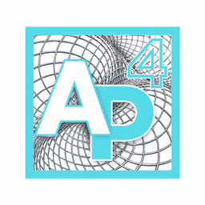

**English** · [Deutsch](README.de.md)

  <picture>
    <source media="(prefers-color-scheme: dark)" srcset="assets/design/icons/dark/4AllPass-dark-256.png">
    
  </picture>

  <a href="https://github.com/landjunge/threaddesk/blob/main/README.md" title="ThreadDesk"><picture>
    <source media="(prefers-color-scheme: dark)" srcset="assets/readme/ThreadDesk-dark-128.png">
    
  </picture></a>
  &nbsp;
  <a href="https://github.com/landjunge/KiraBridge/blob/main/README.md" title="KiraBridge"><picture>
    <source media="(prefers-color-scheme: dark)" srcset="assets/readme/KiraBridge-dark-128.png">
    
  </picture></a>
  &nbsp;
  <a href="https://github.com/landjunge/tollgate/blob/main/README.md" title="TollGate"><picture>
    <source media="(prefers-color-scheme: dark)" srcset="assets/readme/TollGate-dark-128.png">
    
  </picture></a>
  &nbsp;
  <a href="https://github.com/landjunge/agent-authority-lab/blob/master/README.md" title="Agent Authority"><picture>
    <source media="(prefers-color-scheme: dark)" srcset="assets/readme/Agent-Authority-dark-128.png">
    
  </picture></a>

<h1 align="center">4AllPass</h1>

<strong>A digital vault that belongs to you.</strong>

4AllPass keeps passwords and credentials encrypted on your device. The desktop app helps you import passwords and fill login details. There is no mandatory cloud service.

**Published: [0.1.2-rc.2](https://github.com/landjunge/4AllPass/releases/tag/v0.1.2-rc.2) · October 18, 2026 · Alpha / Preview**

[macOS Intel](https://github.com/landjunge/4AllPass/releases/download/v0.1.2-rc.2/4AllPass_0.1.2-rc.2_x64.dmg) · [macOS Apple Silicon](https://github.com/landjunge/4AllPass/releases/download/v0.1.2-rc.2/4AllPass_0.1.2-rc.2_aarch64.dmg) · [Windows x64](https://github.com/landjunge/4AllPass/releases/download/v0.1.2-rc.2/4AllPass_0.1.2-rc.2_x64-setup.exe) · [Linux x64](https://github.com/landjunge/4AllPass/releases/download/v0.1.2-rc.2/4AllPass_0.1.2-rc.2_amd64.AppImage)

[Checksums](https://github.com/landjunge/4AllPass/releases/download/v0.1.2-rc.2/SHA256SUMS) · [All downloads and platform evidence](https://github.com/landjunge/4AllPass/releases/tag/v0.1.2-rc.2)

**AI access differs between source and download.** Current source blocks the former handoff of actual vault secrets to AI clients. Published RC2 packages do not contain this later block; their old path could disclose real credentials after “Allow”. Do not use that old path for AI access. A protected production path is not connected yet. [Status and limits](docs/PROTECTED-ACCESS-20261018.md).

## What is available today

- **Desktop vault:** store locally and unlock with your vault password.
- **Browser import:** review and import passwords from Chrome and Firefox.
- **Autofill:** enter credentials through browser extensions without automatically submitting the form.
- **Recovery:** an emergency kit instead of a server reset; sync is optional and no hosted service is offered.

The protected API core and its TollGate adapter have been tested with synthetic data in source. Production AI secret use and protected AI browser sessions remain planned. The encryption boundary applies to the bundled desktop app; a server operator can change a web app delivered by that server. [Security boundary](docs/security-boundary.md).

## Get started

1. **Install.** Download the package for your computer and compare its SHA-256 checksum. Back up an existing vault before updating.
2. **Create a vault.** Choose a separate vault password and keep the emergency kit somewhere safe.
3. **Try a login.** Start with test data and set up the matching browser extension. [Usage and setup](docs/README-HUMAN.md).

The macOS app is not Apple-notarized; Windows packages are unsigned. There has been no independent third-party audit. Touch ID or WebAuthn PRF has not been proven as a desktop unlock path. [Product maturity](docs/product-maturity.md).

## Planned collaboration

The five products remain independent. The goal is a shared workflow with **KiraBridge as the communication hub**:

| Product | Role in the shared workflow |
| --- | --- |
| [ThreadDesk](https://github.com/landjunge/threaddesk/blob/main/README.md) | Keeps project context, knowledge and results. |
| [KiraBridge](https://github.com/landjunge/KiraBridge/blob/main/README.md) | Relays tasks, questions and replies between chat, local agents and tools. |
| [4AllPass](https://github.com/landjunge/4AllPass/blob/main/README.md) | Manages credentials; is intended to enable specifically approved access. |
| [TollGate](https://github.com/landjunge/tollgate/blob/main/README.md) | Checks connected calls and enforces usage limits and stops. |
| [Agent Authority](https://github.com/landjunge/agent-authority-lab/blob/master/README.md) | Shows observations, contradictions and missing evidence; does not approve actions. |

Some interfaces already exist. A fully configured and verified workflow across all five products is still planned. Approvals stay with the responsible tool and the human. KiraBridge and Agent Authority require access to their private repositories.

[Documentation](docs/README.md) · [Developer setup and contributions](docs/DEVELOPERS.md) · [Report security issues](SECURITY.md) · [Product website](https://4allpass.netzwerkpunkt.de/)

## License and contributions

Private, non-business use is free under the [Netzwerkpunkt Personal Use License 1.0](LICENSE). Business use requires separate written permission. The German text governs; historical license rights remain intact.

Product concept and architecture: **Daniel Filipek (landjunge)**. AI assists with implementation and documentation. Feedback and verifiable reviews are welcome.
